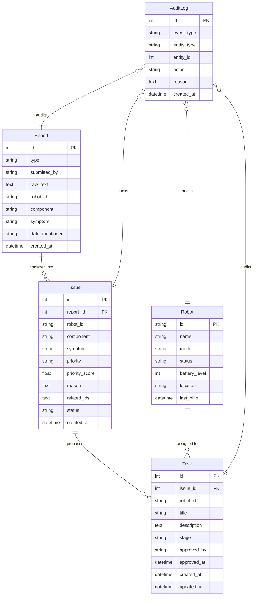

# RoboOps — Unified API Specification & Contract
**Version:** 1.0.0
**Environment:** Development (`http://127.0.0.1:8000`)
**Protocols:** REST / JSON
**Target Clients:** Frontend (React 19 + Vite), Backend (FastAPI + SQLAlchemy)

---

## 1. Architectural Overview & Conventions

### 1.1 Base URL & Headers
- **Base URL:** `http://127.0.0.1:8000`
- **Standard Request Headers:**
  ```http
  Content-Type: application/json
  Accept: application/json
  ```
- **CORS Allowed Origins:**
  - `http://localhost:5173`
  - `http://127.0.0.1:5173`

### 1.2 Date and Time Standards
- All timestamps exchanged via the API must be ISO 8601 strings in UTC:
  - Format: `YYYY-MM-DDTHH:MM:SS.ffffff` or `YYYY-MM-DDTHH:MM:SSZ`
  - Example: `2026-10-27T10:15:30.123456`

### 1.3 Uniform Error Format
All 4xx and 5xx responses conform to FastAPI's standard JSON schema:
```json
{
  "detail": "Descriptive human-readable error message or validation error array"
}
```
Validation failures (`422 Unprocessable Entity`) return:
```json
{
  "detail": [
    {
      "loc": ["body", "raw_text"],
      "msg": "String should have at least 10 characters",
      "type": "string_too_short"
    }
  ]
}
```

---

## 2. Enums and Global Data Types

### 2.1 Enums

#### `ReportType` (string)
| Value | Description |
|---|---|
| `maintenance_report` | Direct report of a hardware/software fault or inspection log |
| `meeting_note` | Unstructured recap from daily standups or team engineering syncs |

#### `Priority` (string)
Computed deterministically by the rule-based priority engine ($0–100$ scale).
| Value | Score Range | Description |
|---|---|---|
| `low` | $0.0 \le \text{score} < 35.0$ | Minor cosmetic wear, non-blocking sensors |
| `medium` | $35.0 \le \text{score} < 55.0$ | Mechanical friction, noise, intermittent drift |
| `high` | $55.0 \le \text{score} < 75.0$ | Overheating, connection drops, critical component error |
| `critical` | $75.0 \le \text{score} \le 100.0$ | Sparking, burning smell, power failure, motor stall |

#### `IssueStatus` (string)
| Value | Description |
|---|---|
| `open` | Issue identified from report analysis; awaiting task proposal |
| `task_proposed` | Draft task created; awaiting human approval |
| `closed` | Maintenance task verified and complete |

#### `TaskStage` (string)
Strict sequential order for simulation:
$$\text{draft} \xrightarrow{\text{Human Approval}} \text{awaiting\_approval} \xrightarrow{\text{Advance}} \text{dispatched} \xrightarrow{\text{Advance}} \text{in\_progress} \xrightarrow{\text{Advance}} \text{complete}$$

| Value | Human Gate Required? | Description |
|---|---|---|
| `draft` | **Yes (Approval Gate)** | Initial stage created from issue. Cannot be simulated. |
| `awaiting_approval` | No | Approved by human. Ready for dispatcher execution. |
| `dispatched` | No | Simulated technician/workcell assigned. |
| `in_progress` | No | Active maintenance simulation underway. |
| `complete` | No | Task finished; issue transitions to `closed`. |

#### `RobotStatus` (string)
| Value | Description |
|---|---|
| `idle` | Robot available; no active tasks |
| `dispatched` | Task dispatched to robot workcell |
| `maintenance` | Maintenance currently in progress on robot |
| `offline` | Robot non-operational or undergoing major overhaul |

#### `AuditEventType` (string)
| Value | Emitted When |
|---|---|
| `report_submitted` | New report ingested and fields extracted |
| `issue_created` | Report analyzed and issue generated with priority score |
| `task_proposed` | Draft task created from issue |
| `task_approved` | Human enters signature to approve draft task |
| `task_advanced` | Task transitions to next simulation stage |
| `robot_status_updated` | Robot fleet telemetry or status updated |

---

## 3. Database Entity Specifications & Entity Relationships



---

## 4. Endpoints & API Specifications

### 4.1 System & Health

#### `GET /health`
Validates that the backend service and database connectivity are healthy.
- **Request:** None
- **Response `200 OK`:**
  ```json
  {
    "status": "ok",
    "service": "RoboOps API"
  }
  ```

---

### 4.2 Dashboard Domain

#### `GET /dashboard/summary`
Returns aggregated real-time counts and recent system activity for the Overview Dashboard.
- **Request:** None
- **Response `200 OK`:**
  ```json
  {
    "total_reports": 14,
    "open_issues": 3,
    "pending_approvals": 2,
    "completed_tasks": 8,
    "recent_activity": [
      {
        "event": "Task Approved",
        "detail": "Task #5 approved by Sarah. Ready for simulation.",
        "time": "2026-10-27T08:30:00"
      },
      {
        "event": "Report Submitted",
        "detail": "Report of type 'maintenance_report' submitted.",
        "time": "2026-10-27T08:15:22"
      }
    ]
  }
  ```
- **Failure Cases:**
  - `500 Internal Server Error`: Database query failure or serialization error.

---

### 4.3 Reports Domain

#### `POST /reports`
Submits raw maintenance text or meeting notes. Triggers regex/keyword extraction on submission. Raw text is preserved immutably.
- **Request Body (`application/json`):**
  ```json
  {
    "type": "maintenance_report",
    "submitted_by": "Alice Chen",
    "raw_text": "Robot R2 left wheel motor is making grinding noise since Tuesday. Needs immediate inspection."
  }
  ```
- **Validation Rules:**
  - `type`: Must be `"maintenance_report"` or `"meeting_note"`.
  - `submitted_by`: $1 \le \text{length} \le 100$.
  - `raw_text`: Minimum length 10 characters.
- **Response `201 Created`:**
  ```json
  {
    "id": 1,
    "type": "maintenance_report",
    "submitted_by": "Alice Chen",
    "raw_text": "Robot R2 left wheel motor is making grinding noise since Tuesday. Needs immediate inspection.",
    "extracted": {
      "robot_id": "R2",
      "component": "left wheel motor",
      "symptom": "grinding noise",
      "date_mentioned": "Tuesday"
    },
    "created_at": "2026-10-27T08:12:05.323735"
  }
  ```
- **Side Effects:**
  - Appends an entry to `audit_logs` with `event_type = "report_submitted"`.

#### `GET /reports`
Returns all submitted reports ordered newest first.
- **Request:** None
- **Response `200 OK`:**
  ```json
  [
    {
      "id": 1,
      "type": "maintenance_report",
      "submitted_by": "Alice Chen",
      "raw_text": "Robot R2 left wheel motor is making grinding noise since Tuesday.",
      "extracted": {
        "robot_id": "R2",
        "component": "left wheel motor",
        "symptom": "grinding noise",
        "date_mentioned": "Tuesday"
      },
      "created_at": "2026-10-27T08:12:05.323735"
    }
  ]
  ```

#### `GET /reports/{report_id}`
Returns a single report by ID.
- **Request Parameters:** `report_id` (integer, path)
- **Response `200 OK`:** Single `ReportOut` object.
- **Failure Cases:**
  - `404 Not Found`: `{"detail": "Report {report_id} not found."}`

---

### 4.4 Issue Intelligence Domain

#### `GET /issues`
Returns all issues generated from analyzed reports, newest first.
- **Query Parameters (optional):**
  - `status`: filter by `"open"`, `"task_proposed"`, `"closed"`
  - `priority`: filter by `"low"`, `"medium"`, `"high"`, `"critical"`
- **Response `200 OK`:**
  ```json
  [
    {
      "id": 1,
      "report_id": 1,
      "robot_id": "R2",
      "component": "left wheel motor",
      "symptom": "grinding noise",
      "priority": "medium",
      "priority_score": 53.2,
      "reason": "Component 'left wheel motor' has a criticality score of 28/30. Symptom 'grinding noise' has a severity score of 22/40. Total priority score: 53/100.",
      "related_issue_ids": [],
      "status": "open",
      "created_at": "2026-10-27T08:12:12.320563"
    }
  ]
  ```

#### `GET /issues/{issue_id}`
Returns detailed information for a single issue.
- **Request Parameters:** `issue_id` (integer, path)
- **Response `200 OK`:** Single `IssueOut` object.
- **Failure Cases:**
  - `404 Not Found`: `{"detail": "Issue {issue_id} not found."}`

#### `POST /reports/{report_id}/analyze`
Analyzes an existing report and derives a structured `Issue`.
1. Executes `issue_matcher.py` to link similar issues and count past 14-day recurrences.
2. Executes `priority_engine.py` to assign normalized 0–100 score and explicit rationale.
3. Emits `AuditLog` entry.
- **Request Parameters:** `report_id` (integer, path)
- **Response `201 Created`:** Single `IssueOut` object.
- **Failure Cases:**
  - `404 Not Found`: `{"detail": "Report {report_id} not found."}`

#### `POST /issues/{issue_id}/propose-task`
Creates a draft maintenance task from an Issue.
- **Request Parameters:** `issue_id` (integer, path)
- **Response `201 Created`:**
  ```json
  {
    "id": 1,
    "issue_id": 1,
    "robot_id": "R2",
    "title": "Inspect left wheel motor on R2",
    "description": "Proposed from Issue #1. Symptom: grinding noise. Priority: medium. Reason: Component 'left wheel motor' has a criticality score of 28/30. Symptom 'grinding noise' has a severity score of 22/40. Total priority score: 53/100.",
    "stage": "draft",
    "approved_by": null,
    "approved_at": null,
    "created_at": "2026-10-27T08:12:27.325499",
    "updated_at": "2026-10-27T08:12:27.325504"
  }
  ```
- **State Transition:**
  - `Issue.status` transitions from `"open"` to `"task_proposed"`.
- **Failure Cases:**
  - `404 Not Found`: `{"detail": "Issue {issue_id} not found."}`
  - `409 Conflict`: `{"detail": "A task has already been proposed for this issue."}`

---

### 4.5 Task Board & Simulation Domain

#### `GET /tasks`
Returns all maintenance tasks, newest first.
- **Query Parameters (optional):**
  - `stage`: filter by `TaskStage`
  - `robot_id`: filter by robot (e.g. `R2`)
- **Response `200 OK`:**
  ```json
  [
    {
      "id": 1,
      "issue_id": 1,
      "robot_id": "R2",
      "title": "Inspect left wheel motor on R2",
      "description": "Proposed from Issue #1...",
      "stage": "draft",
      "approved_by": null,
      "approved_at": null,
      "created_at": "2026-10-27T08:12:27.325499",
      "updated_at": "2026-10-27T08:12:27.325504"
    }
  ]
  ```

#### `GET /tasks/{task_id}`
Returns a single task by ID.
- **Request Parameters:** `task_id` (integer, path)
- **Response `200 OK`:** Single `TaskOut` object.
- **Failure Cases:**
  - `404 Not Found`: `{"detail": "Task {task_id} not found."}`

#### `POST /tasks/{task_id}/approve`
**Human-in-the-Loop Approval Gate.** A human operator explicitly approves a task in `draft` stage. This is the only valid way to transition out of `draft`.
- **Request Parameters:** `task_id` (integer, path)
- **Request Body (`application/json`):**
  ```json
  {
    "approved_by": "Marcus Vance"
  }
  ```
- **Validation Rules:**
  - `approved_by`: non-empty string, $1 \le \text{length} \le 100$.
- **Response `200 OK`:**
  ```json
  {
    "id": 1,
    "issue_id": 1,
    "robot_id": "R2",
    "title": "Inspect left wheel motor on R2",
    "description": "Proposed from Issue #1...",
    "stage": "awaiting_approval",
    "approved_by": "Marcus Vance",
    "approved_at": "2026-10-27T08:35:10.102391",
    "created_at": "2026-10-27T08:12:27.325499",
    "updated_at": "2026-10-27T08:35:10.102391"
  }
  ```
- **Failure Cases:**
  - `404 Not Found`: `{"detail": "Task {task_id} not found."}`
  - `409 Conflict`: `{"detail": "Task is already in stage '{stage}' — only 'draft' tasks can be approved."}`
  - `422 Unprocessable Entity`: missing or empty `approved_by`.

#### `POST /tasks/{task_id}/advance`
Simulates advancement through the operational workflow.
- **Valid Transition Steps:**
  - `awaiting_approval` $\rightarrow$ `dispatched`
  - `dispatched` $\rightarrow$ `in_progress`
  - `in_progress` $\rightarrow$ `complete`
- **Request Parameters:** `task_id` (integer, path)
- **Response `200 OK`:** Updated `TaskOut` object with new `stage` and refreshed `updated_at`.
- **Side Effects upon reaching `complete`:**
  - Associated `Issue.status` transitions to `"closed"`.
  - Appends `AuditLog` entry.
- **Failure Cases:**
  - `404 Not Found`: `{"detail": "Task {task_id} not found."}`
  - `409 Conflict`:
    - If `stage == "draft"`: `{"detail": "Task must be approved by a human before it can be dispatched. Use POST /tasks/{id}/approve first."}`
    - If `stage == "complete"`: `{"detail": "Task 1 is already at final stage 'complete'."}`

---

### 4.6 Robot Fleet Domain

Replaces client-side hardcoded arrays with a formal API contract.

#### `GET /robots`
Returns all robots registered in the operations fleet.
- **Request:** None
- **Response `200 OK`:**
  ```json
  [
    {
      "id": "R1",
      "name": "RoboCourier Alpha",
      "model": "TurtleBot 4",
      "status": "idle",
      "battery_level": 94,
      "location": "Sector A - Bay 1",
      "active_task_id": null,
      "last_ping": "2026-10-27T08:40:00"
    },
    {
      "id": "R2",
      "name": "RoboArm Beta",
      "model": "UR5e Workcell",
      "status": "maintenance",
      "battery_level": 78,
      "location": "Sector B - Assembly",
      "active_task_id": 1,
      "last_ping": "2026-10-27T08:41:15"
    }
  ]
  ```

#### `GET /robots/{robot_id}`
Returns details and telemetry for a specific robot.
- **Request Parameters:** `robot_id` (string, path; e.g. `R2`)
- **Response `200 OK`:** Single robot object.
- **Failure Cases:**
  - `404 Not Found`: `{"detail": "Robot {robot_id} not found."}`

---

### 4.7 Evaluation & Audit Domain

#### `GET /audit`
Returns the append-only, immutable event log ordered reverse-chronologically.
- **Query Parameters (optional):**
  - `event_type`: filter by `AuditEventType`
  - `limit`: default 100, max 500
- **Response `200 OK`:**
  ```json
  [
    {
      "id": 12,
      "event_type": "task_approved",
      "entity_type": "task",
      "entity_id": 1,
      "actor": "Marcus Vance",
      "reason": "Task #1 approved by Marcus Vance. Ready for simulation.",
      "created_at": "2026-10-27T08:35:10.102391"
    },
    {
      "id": 11,
      "event_type": "task_proposed",
      "entity_type": "task",
      "entity_id": 1,
      "actor": "system",
      "reason": "Draft task proposed from Issue #1. Awaiting human approval.",
      "created_at": "2026-10-27T08:12:27.325499"
    }
  ]
  ```

---

## 5. Client Handling: Expected Loading and Failure States

### 5.1 Frontend State Conventions

| State | Client UI Behavior | Error Code / Trigger |
|---|---|---|
| **Initial Fetch** | Display `LoadingSpinner` or skeleton cards | Request pending |
| **Empty State** | Display contextual empty-state icon and action prompt | Response is `[]` or `count == 0` |
| **Validation Error** | Highlight invalid input; display banner message | HTTP 422 with field-level details |
| **Workflow Conflict** | Keep current view open; display descriptive `ErrorBanner` | HTTP 409 (e.g. attempting to advance draft task) |
| **Network Loss** | Display persistent error ribbon with a **"Retry"** button | Fetch throws `TypeError: Failed to fetch` |
| **Optimistic Action** | Disable action button, show progress indicator (`"Submitting…"` or `"Analyzing…"`) | On click of Action buttons |

### 5.2 Frontend Polling / Refresh Strategy
- Mutation actions (e.g. submitting a report, approving a task, advancing a simulation stage) must trigger an immediate refetch of the affected collection (`load()` callback).
- The overview dashboard should refetch when navigated to, or at an optional 30-second interval if auto-refresh is toggled on.

---

## 6. Implementation Checklist for Developers

### Frontend Developers
- [ ] Ensure all API calls are imported from `src/api.js`.
- [ ] Replace hardcoded `ROBOTS = ["R1", ...]` in `Dashboard.jsx` and `TaskBoard.jsx` with calls to `listRobots()`.
- [ ] Add the 2 new page routes in `App.jsx` and `Navbar.jsx`:
  - `/fleet` $\rightarrow$ Fleet Management
  - `/analytics` $\rightarrow$ Operations Analytics & System Performance
- [ ] Display rule-based reasoning transparently on every Issue Card and Task Card.
- [ ] Keep the human approval modal mandatory before triggering task simulation.

### Backend Developers
- [ ] Maintain immutability of `reports.raw_text` and `audit_logs` table.
- [ ] Format enum values using `.value` in log messages (avoid `"ReportType.maintenance_report"`).
- [ ] Return standard HTTP error status codes (`400`, `404`, `409`, `422`) with `{"detail": "..."}`.
- [ ] Ensure database migrations/table definitions reflect the `robots` table alongside existing models.
- [ ] Auto-transition `Issue.status` to `"closed"` when `Task.stage` transitions to `"complete"`.
